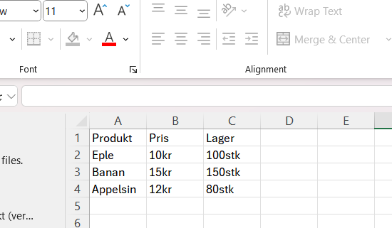
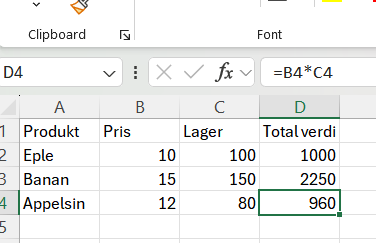

## Last ned seminaroppgavene

Gå inn på canvas eller [uit-bed-1304-h25.github.io](https://uit-bed-1304-h25.github.io) og finn "Oppgaver"

Last ned "Seminar5_Pandas_og_databehandling.ipynb"


## Oppgave 1: Opprette en Pandas DataFrame
Opprett en DataFrame som inneholder informasjon om tre forskjellige produkter:


::: {.fragment fragment-index="1"}
::: {.fragment .fade-out fragment-index="2"}
{.absolute}
:::
:::


**Kolonner**: "Produkt", "Pris", "Lager"

**Data**:

* "Eple", 10 kr, 100 stk
* "Banan", 15 kr, 150 stk
* "Appelsin", 12 kr, 80 stk

Skriv ut hele DataFrame-en.


::: notes
Som i excel men nå i python
:::

## 1 Gjennomgang

```{.python code-line-numbers="|1|4-9|11|14"}
import pandas as pd # Hvis error skriv %pip install pandas først

# Opprett en dictionary med data
data = {
    "Produkt": ["Eple", "Banan", "Appelsin"],
    "Pris i kroner": [10, 15, 12],
    "Lager i antall": [100, 150, 80]
}

# Lag en DataFrame fra dictionaryen
df = pd.DataFrame(data)

# Skriv ut DataFrame
print(df)
```

```{python}
import pandas as pd

# Opprett DataFrame
data = {
    "Produkt": ["Eple", "Banan", "Appelsin"],
    "Pris i kroner": [10, 15, 12],
    "Lager i antall": [100, 150, 80]
}

df = pd.DataFrame(data)

# Skriv ut DataFrame
print(df)
```

::: notes

:::

## Oppgave 2: Filtrere Data i en DataFrame
Bruk DataFrame-en fra Oppgave 1.

Finn og skriv ut alle produkter med en pris over 12 kr.

### Eksempel finner de under 30 år

```{.python}
personer = {
    "Navn": ["Per", "Pål", "Ola"],
    "Høyde": [180, 175, 170],
    "Alder": [30, 25, 35]
}
personer_df = pd.DataFrame(personer)
aldre_under_30 = personer_df[personer_df["Alder"] < 30]
print(aldre_under_30)
```
```{python}
personer = {
    "Navn": ["Per", "Pål", "Ola"],
    "Høyde": [180, 175, 170],
    "Alder": [30, 25, 35]
}
personer_df = pd.DataFrame(personer)
aldre_under_30 = personer_df[personer_df["Alder"] < 30]
print(aldre_under_30)
```


## 2 Gjennomgang

```{.python code-line-numbers="|2"}
# Filtrer produkter med pris over 12 kr
dyre_produkter = df[df["Pris i kroner"] > 12]
print(dyre_produkter)
```

```{python}
# Filtrer produkter med pris over 12 kr
dyre_produkter = df[df["Pris i kroner"] > 12]
print(dyre_produkter)
```

::: notes

:::

## Oppgave 3: Legge til en Ny Kolonne
Legg til en ny kolonne `Total verdi` i DataFrame-en. Den skal vise **pris × lager** for hvert produkt.




. . .

### Eksempel med vekst per år

```{.python}
personer_df["Vekst per år"] = personer_df["Høyde"] / personer_df["Alder"]
print(personer_df)
```


```{python}
personer_df["Vekst per år"] = personer_df["Høyde"] / personer_df["Alder"]
print(personer_df)
```


## 3 Gjennomgang

```{.python code-line-numbers="|2|5"}
# Legg til en ny kolonne som heter 'Total verdi'
df["Total verdi"] = df["Pris i kroner"] * df["Lager i antall"]

# Skriv ut oppdatert DataFrame
print(df)
```


```{python}
# Legg til en ny kolonne som heter 'Total verdi'
df["Total verdi"] = df["Pris i kroner"] * df["Lager i antall"]

# Skriv ut oppdatert DataFrame
print(df)
```

::: notes

:::

## Oppgave 4: Laste Inn Data fra en CSV-fil
Last inn csv-filen ved å trykke på "her" eller skrive inn linken her
[https://github.com/uit-bed-1304-h25/uit-bed-1304-h25.github.io/tree/main/data](https://github.com/uit-bed-1304-h25/uit-bed-1304-h25.github.io/tree/main/data)


Print ut de første fem radene av dataene ved hjelp av funksjonen `df.head()`.


```{.python}
# Les inn CSV-fil
df_student = pd.read_csv("StudentPerformanceFactors.csv")
#Eventuelt 
df_student = pd.read_csv("https://raw.githubusercontent.com/uit-bed-1304-h25/uit-bed-1304-h25.github.io/refs/heads/main/data/StudentPerformanceFactors.csv")

# Vis de første radene
df_student.head()
```


## 4 Gjennomgang

```{.python code-line-numbers="|2|5"}
# Les inn CSV-fil
df_student = pd.read_csv("https://raw.githubusercontent.com/uit-bed-1304-h25/uit-bed-1304-h25.github.io/refs/heads/main/data/StudentPerformanceFactors.csv")

# Vis de første radene
df_student.head()
```

```{python}
# Les inn CSV-fil
df_student = pd.read_csv("https://raw.githubusercontent.com/uit-bed-1304-h25/uit-bed-1304-h25.github.io/refs/heads/main/data/StudentPerformanceFactors.csv")

# Vis de første radene
df_student.head()
```

::: notes
`pd.read_csv()` er en kraftig funksjon for å lese inn data fra CSV-filer. `df.head()` er nyttig for å få et raskt overblikk over de første radene i datasettet uten å skrive ut alt.
:::

## Oppgave 5: Finn Gjennomsnittlig Eksamensscore
Bruk `Pandas` til å finne **gjennomsnittlig eksamensscore** for hele datasettet.

## 5 Gjennomgang

```{.python code-line-numbers="|2|4"}
# Finn gjennomsnittlig eksamensscore
gj_snitt = df_student["Exam_Score"].mean()

print(f"Gjennomsnittlig eksamensscore er {gj_snitt:.2f}")
```

```{python}
# Finn gjennomsnittlig eksamensscore
gj_snitt = df_student["Exam_Score"].mean()

print(f"Gjennomsnittlig eksamensscore er {gj_snitt:.2f}")
```

::: notes
Ved å velge en kolonne (`df_student["Exam_Score"]`) kan vi bruke innebygde statistiske metoder som `.mean()` for å beregne gjennomsnittet.
:::

## Oppgave 6: Tell Antall Elever med og uten Internett
Bruk Pandas til å finne ut hvor mange elever som har tilgang til internett og hvor mange som ikke har det.
Da vil du ha bruk for funksjonen ```value_counts``` til Pandas.


## 6 Gjennomgang

```{.python code-line-numbers="|2|4"}
# Tell hvor mange elever som har tilgang til internett
internett_tilgang = df_student["Internet_Access"].value_counts()

print(internett_tilgang)
```

```{python}
# Tell hvor mange elever som har tilgang til internett
internett_tilgang = df_student["Internet_Access"].value_counts()

print(internett_tilgang)
```

::: notes
`.value_counts()` er en praktisk metode for å telle antall forekomster av hver unike verdi i en kolonne. Dette er spesielt nyttig for kategoriske data.
:::

## Oppgave 7: Histogram over Studietimer
Vis hvor mange elever som går på **Public** vs. **Private** skoler ved hjelp av et stolpediagram.

## 7 Gjennomgang

```{.python code-line-numbers="|2"}
# Lag et stolpediagram over skoletyper
df_student["School_Type"].value_counts().plot(kind="bar", title="Antall elever per Skoletype")
```

```{python}
# Lag et stolpediagram over skoletyper
df_student["School_Type"].value_counts().plot(kind="bar", title="Antall elever per Skoletype")
```

::: notes
Pandas har innebygd funksjonalitet for plotting. Her kombinerer vi `.value_counts()` med `.plot(kind="bar")` for å raskt visualisere fordelingen av elever på ulike skoletyper.
:::

## Oppgave 8 a b og c: Utforsk Dataene med Pandas
I denne oppgaven skal du bruke Pandas' innebygde metoder for å undersøke datasettet om studentenes og deres vaner.

### a) Sjekk informasjon om datasettet
Bruk Pandas til å vise en oversikt over kolonner, datatyper og manglende verdier. .info()


### b) Vis de første 5 radene i datasettet
Se hvordan dataene ser ut ved å hente ut de første radene.

### c) Finn antall rader og kolonner
Bruk Pandas for å finne ut hvor mange rader og kolonner datasettet inneholder.


## Gjennomgang oppgave 8 a 

### a) Sjekk informasjon om datasettet
```{.python}
df_student.info()
```
```{python}
df_student.info()
```

## Gjennomgang oppgave 8 b og c


### b) Vis de første 5 radene i datasettet
```{.python}
df_student.head(5)
```
```{python}
df_student.head(5)
```


### c) Finn antall rader og kolonner
```{.python}
df_student.shape
```
```{python}
df_student.shape
```


## Oppgave 8 d og e: Utforsk Dataene med Pandas

### d) Sjekk om det finnes manglende verdier
Finn ut om noen kolonner har **NaN**-verdier.


### e) Beskriv datasettet med statistikk
Få et raskt overblikk over numeriske kolonner. Bruk `describe()` funksjonen til Pandas. Hva kan vi finne ut her?

## Gjennomgang d og e 


### d) Gjennomgang
```{.python}
df_student.isnull().sum()
```
```{python}
df_student.isnull().sum()
```


### e) Gjennomgang
```{.python}
df_student.describe()
```
```{python}
df_student.describe()
```


::: notes
Disse metodene kan brukes for å se over datasettet. I jupyter så ser dere ved Terminal på bunnen at dere kan åpne datasettet å selv se inni. 
- `.info()` gir en teknisk oppsummering.
- `.head()` viser en forhåndsvisning av dataene.
- `.shape` returnerer dimensjonene (rader, kolonner).
- `.isnull().sum()` teller manglende verdier per kolonne.
- `.describe()` gir deskriptiv statistikk for numeriske kolonner.
:::


